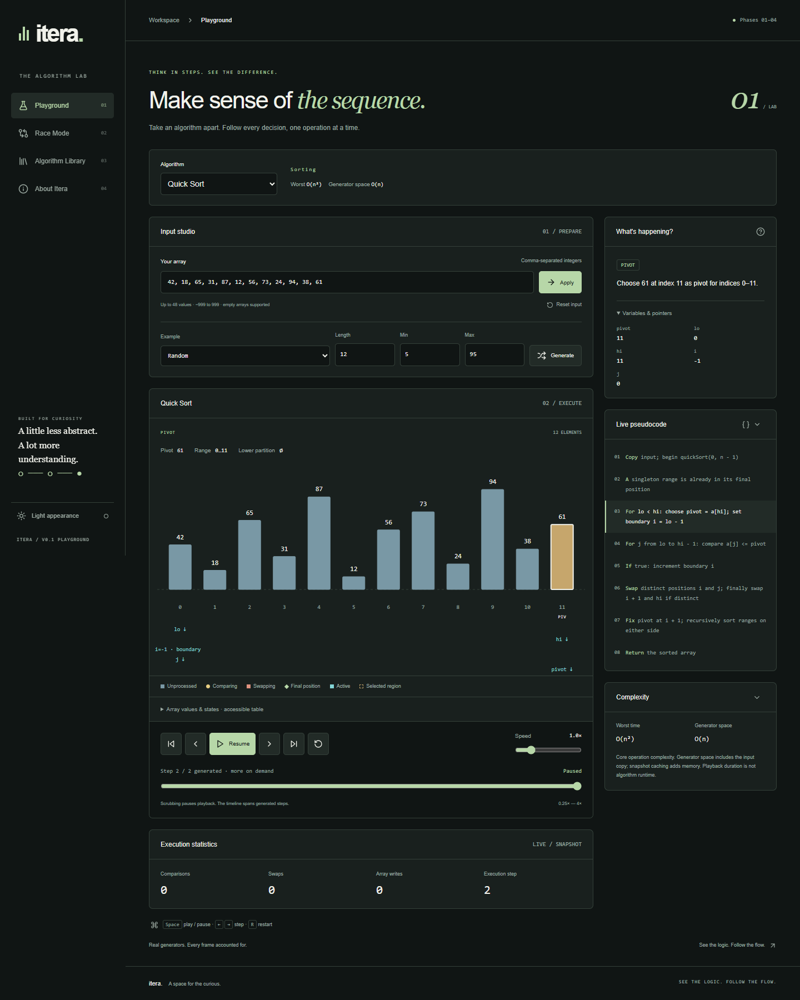
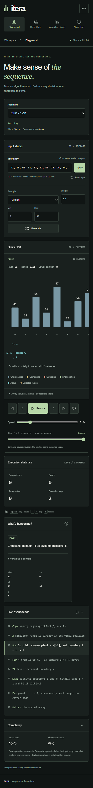

# itera.

**See the logic. Follow the flow.**

A browser-only algorithm learning laboratory built with React, Vite, JavaScript, Tailwind CSS, Motion for React, Lucide, and SVG.

## Current scope

**Phases 1–4 are implemented.** All six generators now power the interactive React playground: full playback controls, snapshot-driven sorting/search/Kadane SVGs, synchronized registry pseudocode, deterministic explanations, algorithm-specific metrics, results, and complexity information. Race Mode and the educational library remain deferred.

The original responsive shell, branding, themes, validation, eight input presets, and reset remain in place. Desktop and mobile Chrome browser verification is covered by the repeatable Playwright suite. Screenshots are included below.

## Local development and verification

Use Node.js 24 (the verified development runtime) and npm.

```sh
npm install
npm run dev
npm test -- --run
npm run lint
npm run build
npm run test:browser
npm run preview
```

Vite prints the local URL. The production build is written to `dist/`. Deploy that directory to a static host only when authorized. No server, authentication, API keys, environment variables, or external AI services are required. No deployment has been created.

## Supported algorithms

| Algorithm / registry ID           | Implementation and edge-case policy                                                                                                                                                                                                            |
| --------------------------------- | ---------------------------------------------------------------------------------------------------------------------------------------------------------------------------------------------------------------------------------------------- |
| Bubble Sort / `bubble-sort`       | Adjacent comparisons, completed passes, sorted suffix, early exit after a pass with no swaps. Stable.                                                                                                                                          |
| Insertion Sort / `insertion-sort` | Hold a key, shift strictly greater values, insert the key. Stable. Shifts are writes, never swaps.                                                                                                                                             |
| Merge Sort / `merge-sort`         | Top-down recursive subdivision with inclusive bounds, separate left/right copies and a merge buffer. Prefer the left value on equality for stability.                                                                                          |
| Quick Sort / `quick-sort`         | Lomuto partitioning, final-element pivot, `<=` lower partition. Distinct-index swaps count even for equal values; self-swaps are skipped. Not stable.                                                                                          |
| Binary Search / `binary-search`   | Iterative search for the **leftmost** matching index. Requires ascending, nondecreasing input and an integer `options.target`. Unsorted input throws a clear validation error; it is never sorted silently. Missing targets return index `-1`. |
| Kadane / `kadane`                 | Nonempty maximum contiguous subarray for nonempty input, including all-negative arrays. Ties prefer earliest start, then earliest end. Empty input returns `{sum:0,start:null,end:null,subarray:[]}`.                                          |

All algorithms accept 0–48 integers in `[-999,999]`, matching the existing input studio. Binary Search targets use the same integer range. Validation runs on the first generator advancement, before any snapshot is yielded; direct consumers receive an error, while `controller.load()` exposes the error in `state.error`. Invalid input never produces a misleading successful result.

Generators copy input at first advancement and never mutate the caller's array. Sorting results are arrays; search results are `{found,index,target}`; Kadane results are `{sum,start,end,subarray}`. Empty sorting input yields an initial and a complete empty state. Empty search input with a valid target yields not found.

## Architecture and registry

- `src/algorithms/`: six generators, shared bookkeeping/validation, and immutable definitions.
- `src/engine/snapshot.js`: the existing deep-clone and recursive-freeze snapshot utility; unchanged.
- `src/engine/algorithmRegistry.js`: the existing registry, now populated with six production definitions.
- `src/engine/playbackController.js`: shared lazy timeline, exact cached navigation, timed playback, and cancellable chunked end-generation. No second React playback engine.
- `src/hooks/usePlayback.js`: existing React subscription and cancellation adapter.
- `src/components/playground/`: registry selection, input studio, playback toolbar, live panels, and workspace integration.
- `src/components/visualization/`: reusable sorting renderer, binary cells, Kadane cells/chart, shared state mapping and accessible table.
- `e2e/playground.spec.js`: actual Chrome desktop/mobile controls, six algorithm flows, validation, themes, console errors, density, and cached replay.
- `src/utils/input.js`: existing strict parsing and presets.
- `tests/`: engine tests, known algorithm fixtures, deterministic property tests, trace invariants, exact metrics, and real-generator playback integration.

Each definition exposes `id`, `name`, `category`, `generate`, `inputRequirements`, `pseudocode`, `complexity`, and `supportedMetrics`. Definitions additionally document stability, core in-place behavior, pivot strategy, duplicate handling, or tie/empty policies where relevant. Registry metadata is deeply frozen. `createRegistry()` remains available for independent registries, preserving its existing API.

```js
import { algorithmRegistry } from "./src/engine/algorithmRegistry.js";
import { createPlaybackController } from "./src/engine/playbackController.js";

const controller = createPlaybackController();
const algorithm = algorithmRegistry.get("binary-search");
controller.load(algorithm.generate, [1, 2, 2, 4], { target: 2 });
controller.end();
console.log(controller.getState().snapshot.result);
// { found: true, index: 1, target: 2 }
controller.previous(); // restores the exact cached snapshot
controller.dispose();
```

Generators isolate mathematical execution from React, timing, and the DOM. Every yield uses the existing `createSnapshot` utility, deep-copies all temporary data, and freezes nested objects. The playback controller caches frames independently and never runs algorithm logic in presentation code.

## Snapshot metadata and pseudocode

The original fields remain: `array`, `highlights`, `pointers`, `variables`, `pseudocodeLine`, `explanation`, `operation`, and `metrics`. Generators add optional backward-compatible fields: `status` (`ready`, `running`, `complete`), `result` (null until completion), and `metadata`. The shared snapshot utility and legacy test-only generators remain compatible.

`pseudocode` is an ordered array of `{id,text}` lines. `pseudocodeLine` is **one-based** and maps to `pseudocode[pseudocodeLine - 1]`; that entry's ID matches the snapshot operation. Definitions describe initialization, recursive work, comparisons, writes/swaps, and completion. Explanations are deterministic and describe the displayed state.

All highlight arrays contain valid zero-based input indices. Pointers may contain boundary sentinels `-1` or `array.length`; renderers must not dereference these. Every range below is inclusive, or null when empty:

- **Bubble:** adjacent `left`/`right` pointers, pass `end`, changed flag, globally final sorted suffix.
- **Insertion:** `variables.key`, `metadata.hole`, `prefixRange`, and shift `from`/`to`. During a shift the array can temporarily show duplicate values: one position is a logical hole, with the key held separately. `highlights.prefix` means a locally sorted prefix, not globally final positions.
- **Merge:** `range`, `leftRange`, `rightRange`, recursion `depth`, immutable `left`, `right`, and `buffer` arrays, temporary-array cursor offsets, and `mergedRange`. `highlights.merged` means locally sorted; only final completion labels all positions globally sorted. Cursor offsets belong to the temporary buffers, while `pointers` refer to input positions.
- **Quick:** active `range`, recursion `depth`, pivot value/index, scan `j`, boundary `i`, `lowerRange`, and globally settled indices. A boundary-advance snapshot may include `pendingSwap`; its destination is excluded from the completed lower range until exchanged.
- **Binary:** `lo`, `mid`, `hi`, target, candidate, comparison result, active `interval`, `searchStatus`, and active/eliminated/found highlights. `mid` is the last examined index and can be outside the reduced interval after elimination. A confirmed candidate is retained separately from the unsearched interval. Eliminated means excluded from the **leftmost result**, not necessarily unequal to the target.
- **Kadane:** current element/index, current/best sums and start/end boundaries, `currentRange`, `bestRange`, and running-sum chart history. A processing frame precedes a separate best-update frame when a new optimum is recorded. A first best candidate counts as a best update.

A final algorithm snapshot has `status: complete` and `operation: complete`. The controller's `state.complete` means its iterator has been exhausted; it becomes true after advancing once beyond the final yielded frame. These are separate concepts.

## Operation-counting conventions

Counters are cumulative and immutable in each frame. Only `supportedMetrics` should be displayed; legacy zero-valued `comparisons`, `swaps`, and `writes` fields remain for contract compatibility.

- **Comparisons:** one value comparison per emitted `compare` operation. Excludes loop conditions and input/sortedness validation. Binary Search counts one conceptual three-way key comparison per iteration, not individual JavaScript equality/ordering operators.
- **Swaps:** exchanges between distinct input positions, with two main-array writes. Self-swaps do not yield swap frames or increment counters.
- **Writes:** assignment to a main working-array position, including shifts, key insertions, and merge writes. Key insertion counts even when it writes back to the original position. Initial input copies and temporary-array copies are excluded.
- **Buffer writes:** Merge Sort's appended output-buffer values. Separate from main-array writes; creating the left/right copies is setup and not included.
- **Iterations:** Binary Search iterations; one per inspected midpoint, excluding validation.
- **Elements processed / best updates:** Kadane's visited elements and strictly improved best sums, including initialization of its first best. Equal best sums do not count as updates. Scalar arithmetic is not reported as array writes or sorting comparisons.
- **Steps:** one per yielded state, including initialization, boundary changes, completed passes, and final completion. The first snapshot has step 1. Step count is not execution time or a universal cross-algorithm cost unit.

## Complexity

Time below describes **core algorithm operations**, excluding validation and visualization instrumentation. Space distinguishes the classical core from this non-mutating generator's input copy and tracing state. Cached snapshots cost additional memory.

| Algorithm | Best       | Average    | Worst      | Core auxiliary space         | Generator auxiliary space, excluding cached snapshots |
| --------- | ---------- | ---------- | ---------- | ---------------------------- | ----------------------------------------------------- |
| Bubble    | O(n)       | O(n²)      | O(n²)      | O(1)                         | O(n)                                                  |
| Insertion | O(n)       | O(n²)      | O(n²)      | O(1)                         | O(n)                                                  |
| Merge     | O(n log n) | O(n log n) | O(n log n) | O(n)                         | O(n)                                                  |
| Quick     | O(n log n) | O(n log n) | O(n²)      | O(log n) average; O(n) worst | O(n)                                                  |
| Binary    | O(log n)   | O(log n)   | O(log n)   | O(1)                         | O(n)                                                  |
| Kadane    | O(n)       | O(n)       | O(n)       | O(1)                         | O(n)                                                  |

Binary Search continues left even on a match, so its nonempty-input best search cost is logarithmic. Sortedness validation adds O(n); validation plus core search is O(n), excluding trace work. Quick Sort's fixed pivot can produce quadratic work on sorted, reverse-sorted, and all-equal inputs. Kadane's O(n) generator space includes the running-sum history for its future chart.

Every snapshot clones O(n) array/metadata state; a trace of S snapshots therefore adds O(S·n) time and cached memory beyond core operations. Highlight construction also adds trace work. Animation duration must never be presented as computational execution time.

## Playback compatibility and limits

Verified with all six production generators: stepping, exact backward restoration, seeking, restart, completion, cancellation, algorithm switching, input replacement, and default cache capacity.

The controller owns timed playback and chunk scheduling. Those modes are mutually exclusive. Play/pause/resume and live speed changes (0.25×–4×) remain separate from generators. Input or algorithm replacement closes the suspended generator and cancels pending timers/chunks. Cached replay stops at its actual final frame. `state.finalGenerated` records a known final algorithm frame even before iterator exhaustion; `state.generating` identifies an active chunked end request.

Caching is bounded at **20,000 snapshots, with no eviction**. Cache overflow stops generation and exposes a clear error. Existing frames remain navigable with previous/next, restart, and seek; seeking beyond available data stops at the last cached frame. No frame is silently substituted or regenerated. After an error, timed playback remains stopped; reload with a smaller input to generate a fresh run. Both overflow and generator-error cached navigation have regression coverage. All tested maximum-size algorithm traces fit below the default cap.

Forward seeking generates only requested frames. The UI scrubber seeks only within already generated frames and pauses playback. Jump-to-end uses `endAsync()` in batches of at most 64 snapshots (128 maximum if configured), with an approximately 8 ms per-chunk work budget and a yield between chunks. Pause, seek, restart, input/algorithm replacement, navigation away, and unmount cancel it. It returns a promise resolving true on exhausted completion or false on cancellation/error. The original synchronous `end()` remains available for tests/API compatibility; the UI never calls it. UI input is not persisted across reloads; theme preference alone is stored locally.

## Next phases

- **Phase 4 complete:** interactive rendering and playback integration, chunked end-generation, synchronized panels, supported metrics, keyboard controls, responsive layout, and browser verification.
- **Phase 5:** race mode with identical starting inputs, independent timelines, documented synchronization, and a fair comparison summary.
- **Phase 6:** educational algorithm library, accessibility and animation polish, browser-level interaction verification.

## Screenshots and demo

Screenshots below are generated by the browser suite from the actual app. No demo GIF or live deployment has been created.





## Using the interactive playground

Select any registered algorithm. Edit the comma-separated array, then Apply, or generate a preset using the chosen bounds. Draft input and target changes immediately pause the current execution; until applied, the canvas is explicitly labeled as the previous committed execution. Invalid input preserves that last valid state. Generation-settings validation is independent of manual array application.

Binary Search requires sorted input. The app shows its validation message and an explicit **Sort input explicitly** action that changes the visible input only when requested. Targets are applied separately. Results identify the leftmost match or a missing target.

Controls include Play/Pause/Resume, previous/next, restart, beginning/end, a live 0.25×–4× slider, and a generated-frame timeline. Seeking pauses. Partial counts say **generated · more on demand**; only a known final snapshot or exhausted iterator is labeled as a total. During end-generation, Cancel stops at the currently generated state. Space, left/right arrows, and R control playback when focus is outside inputs, buttons, selectors, editable content, or scrollable visualizations. Native scrolling remains available in focused canvas regions.

All panels render the current snapshot. Insertion holes show a dashed empty position and the separately held key; shifts never appear as swaps. Merge shows copied left/right arrays and the actual output buffer. Quick shows pivot, scan/boundary pointers, lower range and pending exchanges. Search pointer labels use separate rows, including shared-cell and sentinel states. Kadane charts only observed running sums, including negatives and zero, alongside current/best ranges and completion output.

Bars and values snap directly to exact snapshot positions. Finite color transitions run only during timed forward playback and are shorter than a tick; manual steps, pause, seek, backward movement, and reduced-motion settings show exact states without interpolated value movement. This avoids implying a swap or shift that the generator did not perform. Text labels, distinct borders, legends, explanations and an expandable values/states table provide alternatives to color and animation.

The canvas measures available width. Small arrays fit; dense arrays use contained horizontal scrolling with a visible hint and readable labels. Pseudocode and complexity panels collapse. The existing navigation, dark/light appearance and workspace input are preserved when switching pages; leaving the playground pauses playback. Screen-reader behavior has not been tested with an actual assistive-technology session.

### Browser verification

`npm run test:browser` launches the installed Chrome browser headlessly at 1440×1000 and 390×844, with reduced motion. The suite starts/reuses the local Vite server and asserts zero page/console errors. Chrome must be installed; use Playwright's supported browser installation/channel configuration for other machines. Browser tests require permission to launch Chrome in restricted environments. Failed-test traces are saved under ignored `test-results/`; `playwright-report/` is reserved for optional HTML reporting. Runtime dependencies were unchanged; React Testing Library, jsdom, and Playwright were added only as development dependencies.
